<div align="center">

# WhiteRose

**A light, efficient Wayland desktop for Ubuntu and Fedora.**

Its own compositor, shell, session daemon and apps, designed together from one Figma file.

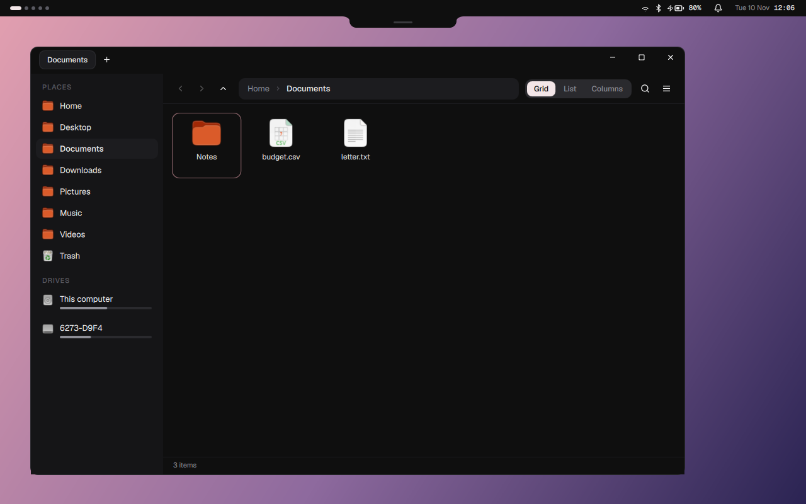

</div>

WhiteRose is a complete desktop. It isn't a theme on GNOME or KDE, and it isn't built on niri or Hyprland. A Rust compositor draws the screen, a QuickShell (QML) shell draws the bar, island, panels and Settings, a Go daemon talks to the rest of the system, and its own apps (Files, Notepad) are built with Qt Quick and Rust. Efficiency comes first: nothing polls, nothing redraws that didn't change, and anything not on screen isn't running.

---

## Screenshots

<table>
  <tr>
    <td width="50%">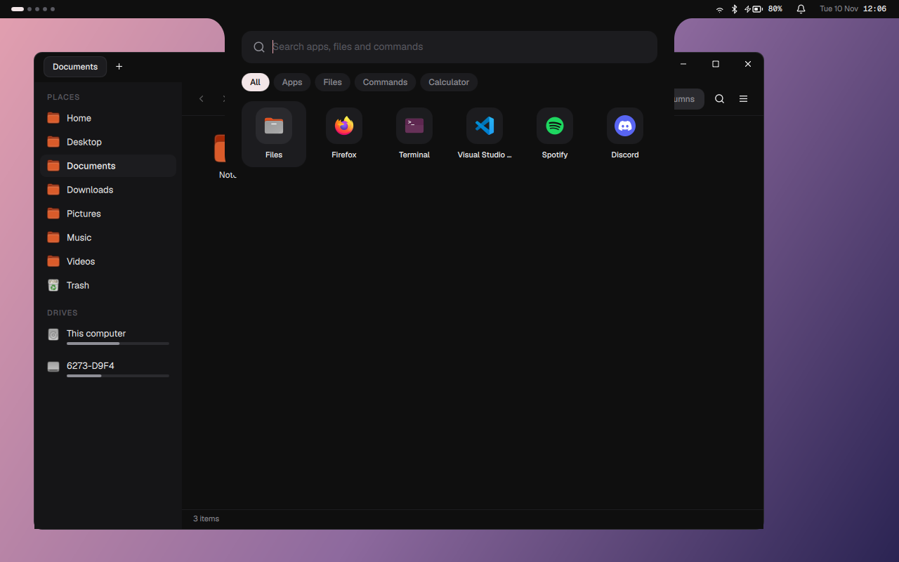<br><sub><b>Launcher</b>: apps, files, commands and a calculator, from the island (SUPER)</sub></td>
    <td width="50%">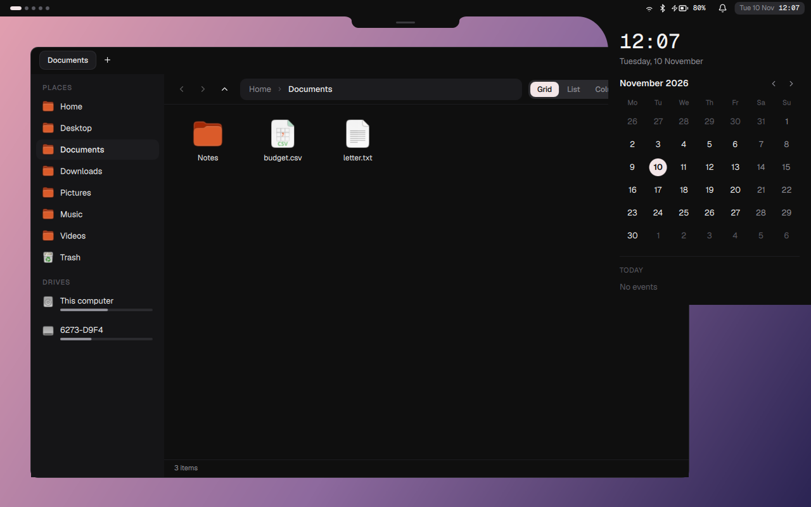<br><sub><b>Calendar</b>: from the clock, with events and the weather</sub></td>
  </tr>
  <tr>
    <td>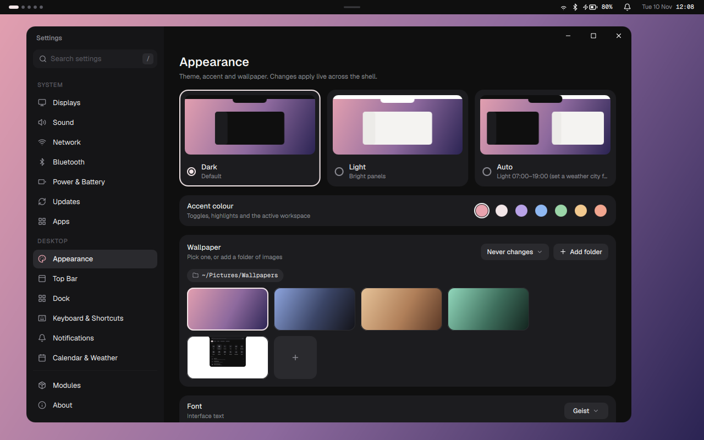<br><sub><b>Settings › Appearance</b>: theme, accent, wallpapers, fonts, live across the shell</sub></td>
    <td>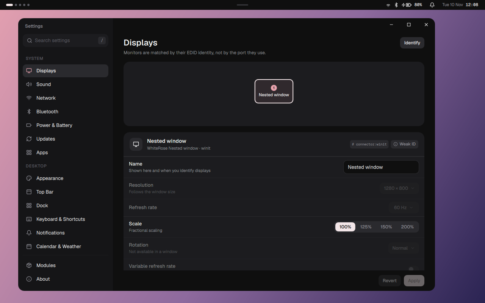<br><sub><b>Settings › Displays</b>: monitors known by their EDID, not the port they're in</sub></td>
  </tr>
  <tr>
    <td>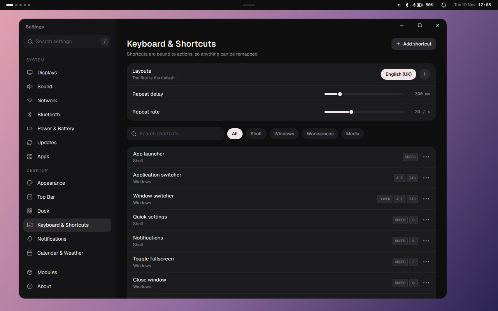<br><sub><b>Settings › Keyboard & Shortcuts</b>: every shortcut is an action, so anything can be remapped</sub></td>
    <td>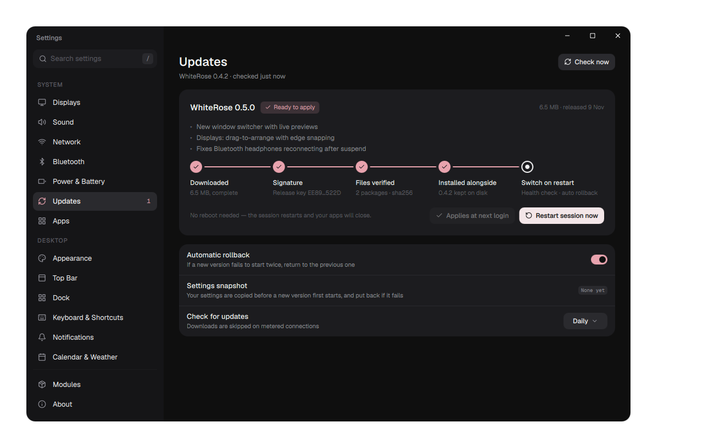<br><sub><b>Settings › Updates</b>: signed, installed beside the running version, switched with a health check</sub></td>
  </tr>
</table>

## Designs

Every screen starts in Figma, and the code follows the frames closely. A few of them:

<table>
  <tr>
    <td width="50%">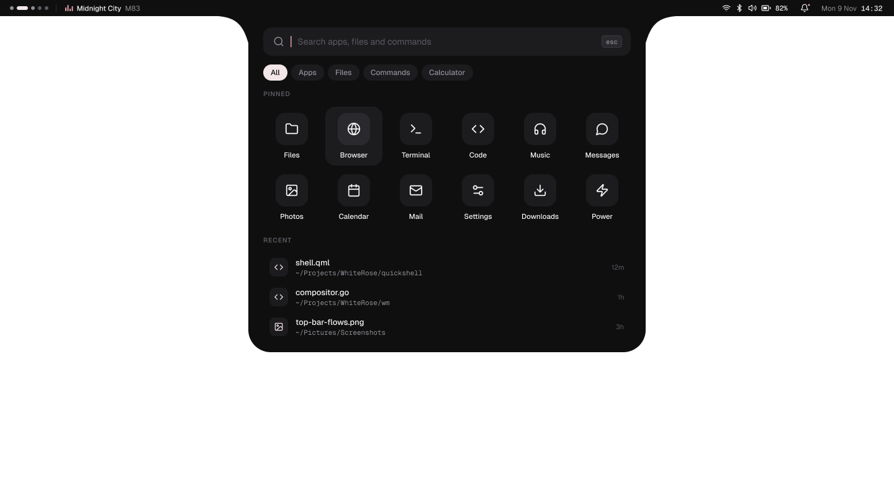<br><sub>App Launcher</sub></td>
    <td width="50%">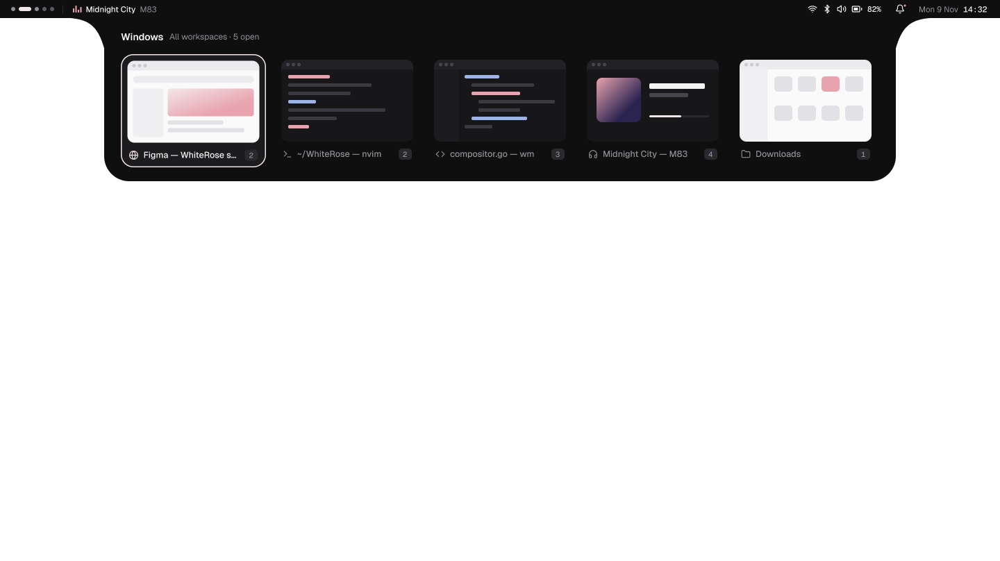<br><sub>Window Switcher (SUPER + ALT + TAB)</sub></td>
  </tr>
  <tr>
    <td>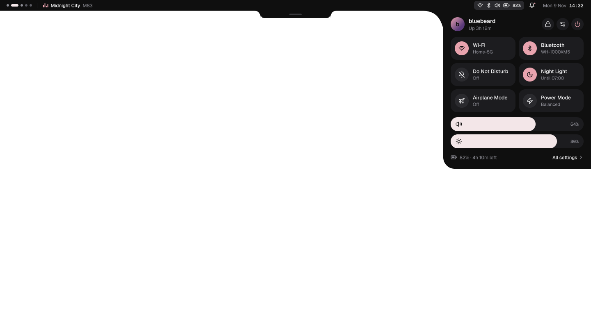<br><sub>Quick Settings</sub></td>
    <td>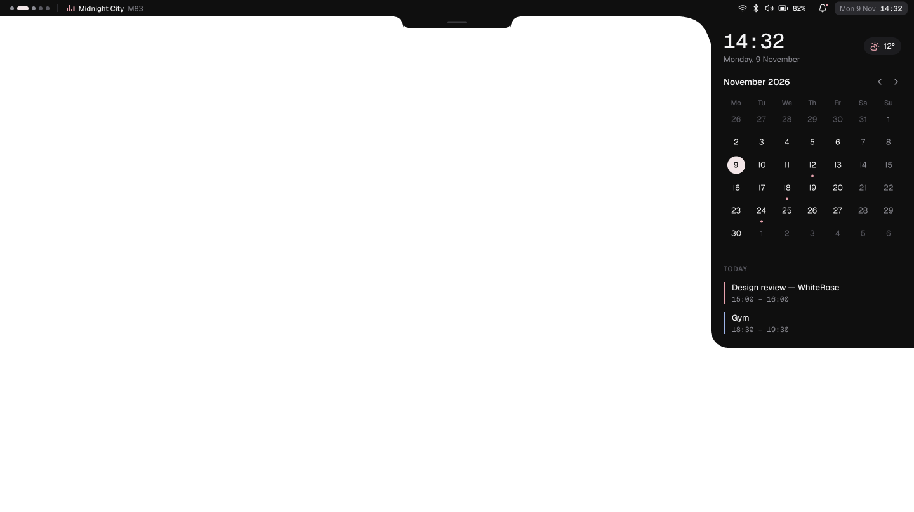<br><sub>Calendar</sub></td>
  </tr>
  <tr>
    <td>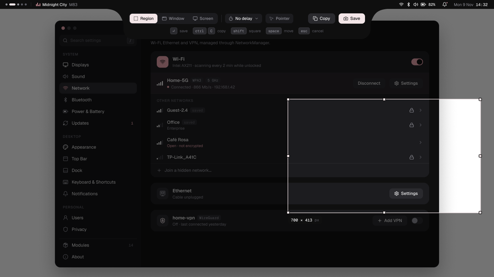<br><sub>Screenshot: Region (SUPER + SHIFT + S)</sub></td>
    <td>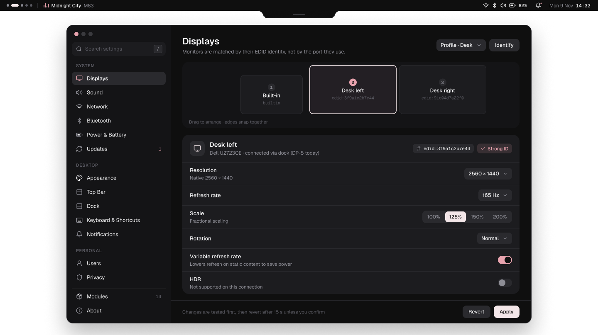<br><sub>Settings › Displays</sub></td>
  </tr>
</table>

---

## Features

### The desktop
- **The island:** one shape hanging from the top bar that morphs between every view: the dock, the launcher, clipboard history, recent screenshots, the switchers, and prompts. It tucks into the bar when a maximized window sits under it.
- **Launcher (SUPER):** apps ranked by use, files, commands, and a calculator, with tabs to narrow it down.
- **Switchers:** ALT+TAB between apps, SUPER+ALT+TAB between windows, with live previews.
- **Dock:** pinned and running apps, with window previews on hover.
- **Quick settings:** Wi-Fi, Bluetooth, Do Not Disturb, Night Light, airplane mode, power mode, brightness, battery.
- **Notifications:** WhiteRose is the notification server: popups, a history panel, actions, Do Not Disturb.
- **Calendar and weather:** a month view with events from your calendars (ICS files and URLs), plus the forecast.
- **Clipboard history:** text, images and files, and drag an entry straight into another app.
- **Screenshots:** region, window or screen, a toolbar in the island, a "saved" toast with open / show / delete, and a tray of recent ones.
- **Lock screen:** password, or a fingerprint at the same time when a finger is enrolled. Locks on suspend and after idle.
- **Password prompts:** the shell is the polkit agent, with fingerprint support when the system's PAM asks for one.
- **Night Light:** warmer colours, on until a time you pick.

### Settings
- **One module per page**, with sub-pages, search across every setting, and a Modules page to turn optional ones off.
- **Displays:** drag to arrange with edge snapping, resolution, refresh rate, fractional scaling, rotation, variable refresh rate, Identify. Monitors are matched by their EDID, so plugging into another port doesn't change anything.
- **Appearance:** dark, light, or automatic (following sunset and sunrise); accent colour; wallpapers, folders of them, rotation; fonts.
- **Keyboard & Shortcuts:** layouts, repeat, and every shortcut remappable, with clashes caught.
- **Network, Bluetooth, Sound, Power & Battery:** including per-connection details, security and IPv4, and a battery charge limit.
- **Users:** names, pictures, passwords, administrators, adding and removing people (AccountsService), plus **Fingerprints** (add, remove, and fingerprint sign-in for sudo and admin prompts).
- **Privacy:** lock and screen-off timing, and what history is kept.
- **Apps:** the apps WhiteRose comes with, installed from the right place for the distribution (repository, vendor, or Flathub).
- **Updates:** see below.

### Files
A full file manager (`apps/files`, Qt Quick + Rust). Its whole checklist is in [`apps/files/FEATURES.md`](apps/files/FEATURES.md).
- Tabs (tear off into a new window, or drop onto another one), dual panes, and grid / list / columns / cards / disk-usage views.
- Nothing pops up over the files: the **Sheet** beside them holds info, rename (many at once, the new names shown in the list), share and compress, connecting to servers and cloud accounts, and compare & sync; copies, moves and clashes go in an **Activity drawer**; questions ask in a strip above the files; new folders are named right where they appear.
- View, sort and grouping remembered per folder, lent to subfolders or used everywhere.
- Instant indexed search with type, size, date and `tag:` filters, inside files too; `whiterose-files --find` from a terminal.
- A transfer queue with pause, resume and side-by-side conflict resolution (a text file's changes line by line). Trash across every drive, with restore.
- Network shares (SMB, SFTP, FTP, WebDAV, NFS), cloud drives (Google Drive, OneDrive, Dropbox, iCloud, S3) and Nextcloud sync badges.
- Previews (Space): images, audio, video, PDF and text.
- Tags stored on the file itself, folder colours and icons, and the current git branch.
- Safe by default: archives are extracted in Rust with path validation, and programs from Downloads, removable drives and similar places only run once you say you trust them.

### Notepad
A plain-text and code editor (`apps/notepad`) with tabs, a scratch tab that keeps its text, and syntax highlighting.

### Updates that can't leave you stuck
- Releases are **signed** (ed25519 over `SHA256SUMS`). Every package is checked before anything is kept, and checked again as root before installing.
- A new version is **installed beside** the running one (`/usr/lib/whiterose/<version>/`). Only **two versions** are ever kept on disk.
- The switch happens at the next login, or by restarting the session, behind a **health check**: the compositor, daemon and shell must all report ready within 20 s, and the session must still be running after 60 s.
- If the new version doesn't come up, your **settings snapshot** is put back and the previous version starts straight away. After two failed tries, the island asks: *Try again*, *Stay on the previous version*, or *View log*.
- No reboots: a session restart applies an update.

### Efficient by design
- Nothing polls: everything is driven by events (D-Bus signals, Wayland events, udev).
- The compositor redraws only the regions that changed, and nothing at all on an idle screen.
- QML timers and animations run only while visible. The search index is built at idle priority and read from disk rather than held in memory.

---

## How it fits together

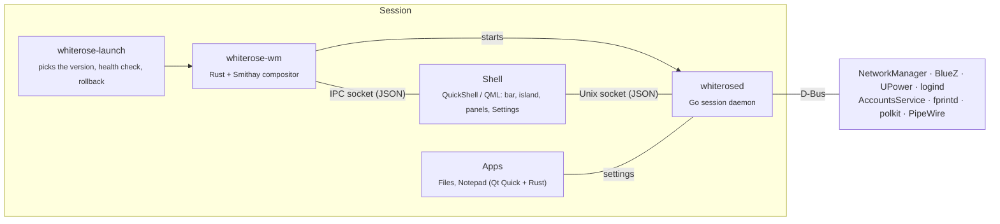

| Part | Language | Job |
|---|---|---|
| `compositor/` (`whiterose-wm`) | Rust, [Smithay](https://github.com/Smithay/smithay) | Rendering, input, windows, workspaces, screen capture, Wayland protocols |
| `shell/` | QML on [QuickShell](https://quickshell.org) | The bar, island, panels, lock screen, prompts and the Settings app. UI only |
| `daemon/` (`whiterosed`, `whiterose-launch`) | Go | Settings database, monitors, network, Bluetooth, power, accounts, fingerprints, calendars, weather, updates, the session launcher |
| `apps/` | Qt Quick + Rust ([cxx-qt](https://github.com/KDAB/cxx-qt)) | Files, Notepad, and the shared `kit` of controls |
| `packaging/` | Shell, nfpm | `.deb` and `.rpm` packages, built in containers |

The design decisions and their reasons are in [`ARCHITECTURE.md`](ARCHITECTURE.md).

---

## Install

WhiteRose runs on **Ubuntu 26.04** and **Fedora 45**. One command downloads the latest release's two packages, checks their signature, and installs them:

```sh
curl -fsSL https://github.com/BlueBeard63/WhiteRose/releases/latest/download/install.sh | sh
```

(`sh install.sh --check` checks without installing.) Or download both packages for your system from the [latest release](https://github.com/BlueBeard63/WhiteRose/releases/latest) and install them together, as a pair: `whiterose` needs its `whiterose-core-<version>`.

```sh
# Ubuntu
sudo apt install ./whiterose-core-*_amd64.deb ./whiterose_*_amd64.deb
# Fedora
sudo dnf install ./whiterose-core-*.x86_64.rpm ./whiterose-*.x86_64.rpm
```

Log out, pick **WhiteRose** on the login screen, and log in. Later updates arrive through **Settings › Updates**.

## Build from source

You'll need Rust, Go, Qt 6 (with its QML modules) and QuickShell.

```sh
make check        # every test: Go (with the race detector), Rust (with clippy) and the shell's JS
make ui-test      # click-and-check tests: real WhiteRose sessions, clicked through by name
make shots        # screenshots for review (the bar, every Settings page as a tile) in build/shots
make run-nested   # WhiteRose in a window on your current desktop
make dev-apps     # Settings, Files and Notepad in your launcher, run from this checkout
make run-tty      # on the real screens: log in on a text console (Ctrl+Alt+F3) first
make package      # the .deb and .rpm, built in Ubuntu and Fedora containers
```

## Repository layout

```
compositor/   whiterose-wm (Rust + Smithay; a vendored, patched Smithay in vendor/)
daemon/       whiterosed and whiterose-launch (Go)
shell/        the QuickShell shell and the Settings app (QML), with pure-JS tests
apps/         Files, Notepad and their shared kit (Qt Quick + Rust)
packaging/    package builds, session files, PAM / polkit, icons, the release key
profile/      the default terminal theme and editor extensions the Apps setup installs
docs/         screenshots and design exports for this page
```

---

## Roadmap

Window management comes next (snap layouts, tiling, scrollable columns), then overview and gestures, look and feel, WhiteRose's own login screen, online accounts, and more distributions. **1.0 is a complete daily driver**, and a sandboxed **Go / Rust / QML module API** follows in 1.x.

[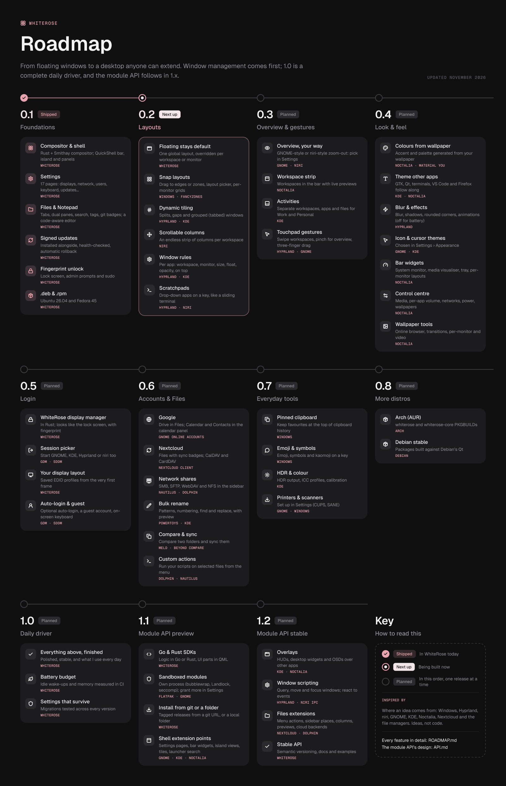](ROADMAP.md)

Every feature in detail: [ROADMAP.md](ROADMAP.md). The module API's design: [API.md](API.md).

## Status

WhiteRose is a personal project in active development, and it's the desktop I use day to day. Expect rough edges, and expect things to change.

## Thanks

WhiteRose stands on [Smithay](https://github.com/Smithay/smithay), [QuickShell](https://quickshell.org), [Qt](https://www.qt.io), [cxx-qt](https://github.com/KDAB/cxx-qt), [godbus](https://github.com/godbus/dbus), the [Lucide](https://lucide.dev) icons, and the Geist typeface.

## License

MIT. See [LICENSE](LICENSE).
