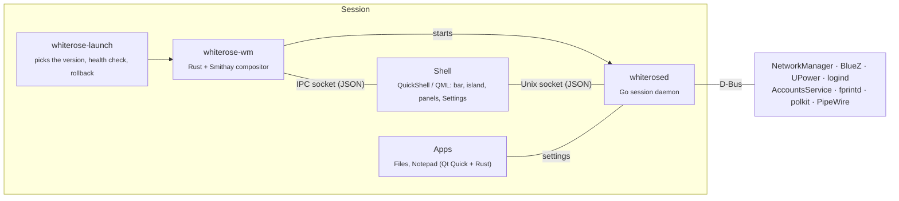

<div align="center">

# WhiteRose

**A light Wayland desktop for Ubuntu and Fedora, built from the ground up.**


[Install](#install) · [Features](#features) · [Screenshots](#screenshots) · [Roadmap](ROADMAP.md) · [Architecture](ARCHITECTURE.md)

</div>

WhiteRose is a complete desktop: its own compositor, shell, session daemon and apps, designed together in one Figma file. It isn't a theme on GNOME or KDE, and it isn't built on niri or Hyprland. Efficiency comes first: nothing polls, nothing redraws that didn't change, and anything not on screen isn't running.

## Install

Ubuntu 26.04 or Fedora 45. One command downloads the latest release, checks its signature and installs it:

```sh
curl -fsSL https://github.com/BlueBeard63/WhiteRose/releases/latest/download/install.sh | sh
```

Then log out, pick **WhiteRose** on the login screen, and log in. Updates arrive through **Settings › Updates**.

<details>
<summary>Installing the packages by hand</summary>

Download both packages for your system from the [latest release](https://github.com/BlueBeard63/WhiteRose/releases/latest) and install them together (`whiterose` needs its `whiterose-core-<version>`):

```sh
# Ubuntu
sudo apt install ./whiterose-core-*_amd64.deb ./whiterose_*_amd64.deb
# Fedora
sudo dnf install ./whiterose-core-*.x86_64.rpm ./whiterose-*.x86_64.rpm
```

`sh install.sh --check` checks a release without installing it.

</details>

## Features

**Windows.** Floating by default, or tiled (dwindle and master-stack, with tabbed groups), chosen for everything and overridden per workspace or monitor. Drag to an edge or into your own snap zones, set per-app window rules, and keep drop-down scratchpads on a key. X11 apps (Spotify, Steam) work like any other window.

**The island.** One shape hanging from the top bar that turns into the launcher, the dock, the switchers, clipboard history, screenshots, a note, the agenda and music. It tucks into the bar under a maximized window.

**The shell.** Quick settings, notifications, a calendar with the weather, night light, and a lock screen with fingerprint unlock. WhiteRose is also the polkit agent and the notification server.

**Settings.** One module per page, with search across every setting: displays (monitors known by their EDID, not the port), appearance, keyboard and shortcuts (every one remappable), network, Bluetooth, sound, power, users and fingerprints, privacy, apps and updates.

**Files and Notepad.** A file manager with tabs, dual panes, indexed search, tags, network shares, cloud drives and no dialogs ([everything it does](apps/files/FEATURES.md)), and a plain-text and code editor.

**Hard to break.** Updates are signed, installed beside the running version and switched behind a health check, with your settings put back if the new one doesn't come up. Running out of memory closes the app at fault, never the session or your terminal. Crashes are recorded, and reporting one takes a key press (SUPER+SHIFT+B).

## Screenshots

<table>
  <tr>
    <td width="50%"><br><sub><b>Launcher</b>: apps, files, commands and a calculator (SUPER)</sub></td>
    <td width="50%"><br><sub><b>Calendar</b>: events and the weather, from the clock</sub></td>
  </tr>
  <tr>
    <td><br><sub><b>Settings › Appearance</b>: theme, accent, wallpapers and fonts</sub></td>
    <td><br><sub><b>Settings › Displays</b>: arranged by drag, matched by EDID</sub></td>
  </tr>
  <tr>
    <td><br><sub><b>Settings › Keyboard & shortcuts</b>: every shortcut remappable</sub></td>
    <td><br><sub><b>Settings › Updates</b>: signed, health-checked, rolled back if needed</sub></td>
  </tr>
</table>

<details>
<summary>The Figma designs they started from</summary>

Every screen starts in Figma, and the code follows the frames closely.

<table>
  <tr>
    <td width="50%"><br><sub>App Launcher</sub></td>
    <td width="50%"><br><sub>Window Switcher (SUPER+TAB)</sub></td>
  </tr>
  <tr>
    <td><br><sub>Quick Settings</sub></td>
    <td><br><sub>Calendar</sub></td>
  </tr>
  <tr>
    <td><br><sub>Screenshot: Region (SUPER+SHIFT+S)</sub></td>
    <td><br><sub>Settings › Displays</sub></td>
  </tr>
</table>

</details>

## How it fits together



| Folder | Built with | Job |
|---|---|---|
| `compositor/` | Rust, [Smithay](https://github.com/Smithay/smithay) (vendored and patched) | `whiterose-wm`: rendering, input, windows and layouts, XWayland, Wayland protocols |
| `shell/` | QML on [QuickShell](https://quickshell.org) | The bar, island, panels, lock screen, prompts and the Settings app. UI only |
| `daemon/` | Go | `whiterosed`: settings, hardware, accounts, calendars, updates, memory; `whiterose-launch`: the session launcher |
| `apps/` | Qt Quick + Rust ([cxx-qt](https://github.com/KDAB/cxx-qt)) | Files, Notepad and their shared `kit` of controls |
| `packaging/` | Shell, nfpm | The `.deb` and `.rpm`, built in containers |

Why it's built this way: [ARCHITECTURE.md](ARCHITECTURE.md).

## Build from source

You'll need Rust, Go, Qt 6 (with its QML modules) and QuickShell.

```sh
make check        # every test: Go (race detector), Rust (clippy) and the shell's JS
make ui-test      # click-and-check tests: real WhiteRose sessions, clicked through by name
make run-nested   # WhiteRose in a window on your current desktop
make dev-apps     # Settings, Files and Notepad in your launcher, run from this checkout
make run-tty      # on the real screens (log in on a text console, Ctrl+Alt+F3, first)
make package      # the .deb and .rpm, built in Ubuntu and Fedora containers
```

`make shots` saves screenshots for review in `build/shots`.

## Roadmap

0.3 (layouts, X11 apps, memory protection) is in testing. Next come the overview and gestures, look and feel, WhiteRose's own login screen, online accounts and more distributions. **1.0 is a complete daily driver**, and a sandboxed Go / Rust / QML module API follows in 1.x.

[](ROADMAP.md)

Every feature in detail: [ROADMAP.md](ROADMAP.md). The module API's design: [API.md](API.md).

## Whose desktop this is

WhiteRose is a personal project and the desktop I use every day. Expect rough edges, and expect things to change.

It's built for me first. Commits here mostly go to what I find frustrating or haven't got round to fixing, and to changes that are clearly good; other requests may well not happen, and that's not a judgement on them. If you want it to work differently, **fork it**: it's MIT-licensed for exactly that, and good forks get a link here.

**Forks:** none yet.

## Thanks

WhiteRose stands on [Smithay](https://github.com/Smithay/smithay), [QuickShell](https://quickshell.org), [Qt](https://www.qt.io), [cxx-qt](https://github.com/KDAB/cxx-qt), [godbus](https://github.com/godbus/dbus), the [Lucide](https://lucide.dev) icons and the Geist typeface.

## License

MIT. See [LICENSE](LICENSE).
