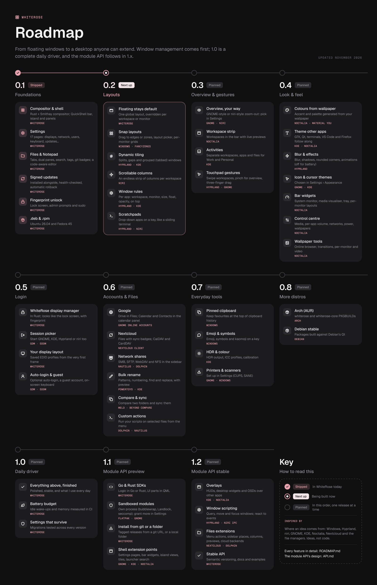

# WhiteRose Roadmap

Where WhiteRose is going, one release at a time. **Window management comes first. 1.0 is a complete daily driver, and the module API follows in 1.x** (its design is in [API.md](API.md)).

Each feature lists where the idea comes from: Windows, Hyprland, niri, GNOME, KDE, Noctalia, Nextcloud and the file managers. These are ideas, not code. Progress is tracked in the [milestones](https://github.com/BlueBeard63/WhiteRose/milestones) on GitHub.

| | Milestone | Theme | What it's about |
|---|---|---|---|
| ✅ | [**0.1**](#01--foundations) | Foundations | What WhiteRose is today. |
| ✅ | [**0.2**](#02--files) | Files | Online drives, network shares, and no dialogs. |
| 🔨 | [**0.3**](#03--layouts) | Layouts | How windows are arranged: three models, one global choice with overrides. |
| 🗓️ | [**0.4**](#04--overview--gestures) | Overview & gestures | Seeing everything at once, and moving around with gestures. |
| 🗓️ | [**0.5**](#05--look--feel) | Look & feel | Making it yours, and making every app match. |
| 🗓️ | [**0.6**](#06--login) | Login | WhiteRose from the first frame: its own display manager. |
| 🗓️ | [**0.7**](#07--accounts--everyday-tools) | Accounts & everyday tools | Your accounts' calendars and contacts, small things used all day, and hardware setup. |
| 🗓️ | [**0.8**](#08--distros--installer) | Distros & installer | Beyond Ubuntu and Fedora, and an ISO installer. |
| 🗓️ | [**1.0**](#10--daily-driver) | Daily driver | Everything above, finished. |
| 🗓️ | [**1.1**](#11--module-api-preview) | Module API preview | Anyone can extend WhiteRose. Design: API.md. |
| 🗓️ | [**1.2**](#12--module-api-stable) | Module API stable | Beyond the shell, and a stable API. |

## 0.1 · Foundations

**Shipped.** What WhiteRose is today.

- **Compositor & shell:** Rust + Smithay compositor; QuickShell bar, island and panels.
- **Settings:** 17 pages: displays, network, users, keyboard, updates and more.
- **Files & Notepad:** Tabs, dual panes, indexed search, tags, the git branch; a code-aware editor.
- **Signed updates:** Installed beside the running version, health-checked, automatic rollback.
- **Fingerprint unlock:** Lock screen, admin prompts and sudo.
- **.deb & .rpm:** Ubuntu 26.04 and Fedora 45.

All of it is described in the [README](README.md) and [ARCHITECTURE.md](ARCHITECTURE.md).

## 0.2 · Files

**Shipped.** A file manager that doesn't get in your way: online drives, network shares, and nothing popping up over your files.

<b>Cloud drives in Files</b>: Google Drive, OneDrive, Dropbox, iCloud Drive, Nextcloud and S3 as folders. · GNOME, rclone

- Add cloud account… (the Files sidebar or ☰) signs in with the browser and asks anything else (iCloud's two-factor code) in Files; opened as folders, cached on disk as used. GNOME Online Accounts' drives show up too.

<b>Nextcloud in Files</b>: sync badges, keep offline, free up space, share links. · Nextcloud

- Folders the Nextcloud or ownCloud desktop client keeps show synced / syncing / waiting / couldn't sync / only in the cloud on every file, through the client's own socket; right-click to keep a file on this device, free up its space, share it or copy its link.

<b>Network shares</b>: SMB, SFTP, FTP, WebDAV and NFS in the Files sidebar. · GNOME, KDE

- Connect to server in the Sheet, hosts from your SSH config, saved servers, passwords in the keyring, host-key questions answered in place. Finding shares nearby by themselves comes in 0.7.

<b>Bulk rename</b>: find and replace (with regular expressions), case, numbering, the extension. · Windows, KDE

- In the Sheet's Rename tab; the new names show in the list as you type, and clashes are marked and skipped.

<b>Compare & sync folders</b>: compare two folders and sync them. · WhiteRose's own

- By size and time or byte by byte; differences marked on the files in both panes; update either way, two-way or mirror (removed files go to the trash); a clashing text file shows its changes line by line.

<b>Custom actions</b>: your own commands on selected files, from the menu. · KDE, GNOME

- Set in Settings › Files › Toolbar & menus: the command, file types, files or folders, in a terminal or not.

<b>Files without dialogs</b>: everything in place, nothing popping up over the files. · WhiteRose's own

- The Sheet (info, rename, share, connect, compare and sync), an Activity drawer for copies and clashes, questions in a strip above the files, new folders named right where they appear. Settings and Notepad work the same way now.

## 0.3 · Layouts

**In progress.** How windows are arranged: three models, one global choice with overrides.

✅ <b>Click-and-check tests</b>: Tests that use WhiteRose like a person would, without guessing where things are on screen. · Qt Test, Playwright

- Every button, row, tab and field has a name; a test says "click Rename in the Sheet, type IMG_, check the list shows lab-day 0412.jpg" and the test harness finds it, clicks it and reads back what's shown.
- Runs in a nested session in CI, for Files, Settings, Notepad and the shell (windows, layouts, the island), with a screenshot kept when something fails.
- Comes first in this milestone: every release after is quicker and safer to change.

✅ <b>Layout engine: floating by default, global with overrides</b>: One layout for everything, overridden per workspace or per monitor, from Settings or a key. · Windows, KDE

- Layout is a property the compositor resolves: monitor override > workspace override > global.
- Settings › Windows: the global layout, and overrides per workspace and per monitor.
- A key cycles the current workspace's layout; the bar shows it.
- Switching layout re-arranges existing windows without losing their floating geometry (restored when switching back).

✅ <b>Snap layouts</b>: Drag to an edge or zone; a layout picker on the maximize button; per-monitor zone grids. · Windows

- Drag a window to an edge/corner to snap to halves/quarters, with a preview.
- Hover the maximize button (WhiteRose's own apps), SUPER+Z, or drag to the top of the screen for a layout picker (halves, thirds, quarters, 2/3 + 1/3).
- Custom zone grids per monitor, or per workspace on a monitor (FancyZones), shown with SHIFT while dragging. Edited in Settings › Snapping (split, merge, draw, delete, move the lines) or at full size on the monitor itself.
- SUPER+SHIFT+arrows snap a floating window, as Win+arrows do.
- Snapped windows resize together when you drag their shared edge.

✅ <b>Dynamic tiling</b>: Windows fill the screen automatically, with gaps, splits and grouped (tabbed) windows. · Hyprland, KDE

- Dwindle and master-stack layouts; gaps inner/outer; smart gaps with one window.
- Keyboard: focus/move/swap in four directions, resize splits, toggle split direction.
- Mouse: drag a tile to swap, split or float it; drag the gap between tiles to resize.
- Groups: windows tabbed into one tile (Hyprland groups), with a tab bar.
- Floating windows (dialogs, fixed-size windows, ones you float) sit above tiles; by app comes with window rules.

✅ <b>Window rules</b>: Per-app rules: workspace, monitor, size, floating, opacity, always on top. · Hyprland, KDE

- Match by app id and the title it opens with (regular expressions); every rule that matches applies, and a later one wins.
- Actions: workspace (opened quietly), monitor, float/tile, size and position (or centred), maximized, fullscreen, a snap zone, opacity (focused and not), always on top. Blur and animations come with 0.5.
- Rules apply when a window opens. Edited in place in Settings › Window rules, stored in the settings database; a new rule can start from any open window.

✅ <b>Scratchpads</b>: Drop-down apps toggled with a key, like a terminal that slides down. · Hyprland, niri

- A scratchpad is an app, a key, a size and a place (under the island or centred); the key starts, shows, focuses or hides it. The window it is is the one its key started, so your other windows of that app stay ordinary.
- Slides down from the island and back up; stays above other windows, fullscreen ones too; follows you across workspaces and monitors; can hide when it loses focus.
- Several scratchpads (terminal, notes, music), edited in place in Settings › Scratchpads; their keys show on the Keyboard page too.

## 0.4 · Overview & gestures

**Planned.** Seeing everything at once, and moving around with gestures.

<b>Overview, your choice</b>: A GNOME-style overview or a niri-style zoom-out, chosen in Settings. · GNOME, niri

- GNOME-style: SUPER shows every window and workspace zoomed out, with search on top.
- niri-style: zoom out on the workspaces; drag windows between them.
- Settings › Windows › Overview picks the style (or off); both are compositor-rendered, live.

<b>Workspace strip</b>: Workspaces in the bar with live previews on hover. · Noctalia

- The bar's workspace dots become a strip; hovering shows a live preview; drag windows onto a workspace.
- An option alongside (or instead of) the overview.

<b>Activities</b>: Separate sets of workspaces, apps and files, e.g. Work and Personal. · KDE

- An activity has its own workspaces, dock pins, recent files and wallpaper.
- Switch from the island or a key; apps can be in one activity or all.

<b>Touchpad gestures</b>: Swipe for workspaces, pinch for the overview, three-finger drag; configurable. · Hyprland, GNOME

- 1:1 swipe between workspaces/columns, pinch for the overview, three-finger window drag.
- Settings › Touchpad: gestures to actions.

## 0.5 · Look & feel

**Planned.** Making it yours, and making every app match.

<b>Colours from wallpaper</b>: Accent and palette generated from the wallpaper. · Noctalia

- Material You-style palette extraction (matugen-like) for dark and light.
- Option in Appearance: 'From wallpaper' next to the fixed accents.

<b>Theme other apps</b>: GTK, Qt/KDE apps, terminals, VS Code and Firefox follow WhiteRose's colours and light/dark. · KDE, Noctalia

- Generate GTK3/4 (libadwaita accent), Qt (qt6ct/Kvantum colours), terminal (Ghostty, foot, kitty), VS Code and Firefox themes from the palette.
- Applied on change; each target can be turned off.

<b>Blur & effects</b>: Blur, shadows, rounded window corners, open/close animations; all can be off for battery. · Hyprland

- Compositor: dual-Kawase blur behind panels and (opt-in) windows, shadows, rounded corners.
- Animations with tunable curves; one switch turns all effects off (and on battery automatically).

<b>Icon & cursor themes</b>: Choose icon and cursor themes in Settings › Appearance. · GNOME, KDE

- List installed themes with previews; cursor size; applied to GTK/Qt and the compositor cursor.

<b>Bar widgets</b>: System monitor, media visualiser, system tray, workspace previews; per-monitor bar layouts you arrange. · Noctalia

- A widget model for the bar (left/centre/right zones), arranged by dragging in Settings › Top bar.
- Widgets: CPU/RAM/temps, media with visualiser, StatusNotifierItem tray, keyboard layout, clock styles.

<b>Control centre</b>: A larger panel: media, per-app volume mixer, network list, power profiles, wallpaper switcher. · Noctalia

- Expands quick settings; per-app volume (PipeWire), output/input pickers, Wi-Fi list, power profiles, wallpaper picker.

<b>Wallpaper tools</b>: Online wallpaper browser, slideshow transitions, per-monitor and video wallpapers. · Noctalia

- Browse/download from Wallhaven; transitions between slideshow images; a wallpaper per monitor; video wallpapers (paused when covered, off on battery).

## 0.6 · Login

**Planned.** WhiteRose from the first frame: its own display manager.

<b>WhiteRose display manager</b>: A display manager in Rust whose greeter looks like the lock screen, with fingerprint. · WhiteRose's own

- whiterose-dm: a systemd service, logind seats, PAM (password + fingerprint side by side), VT handling.
- Greeter: whiterose-wm in greeter mode with a QML greeter matching the lock screen: users with pictures, clock, wallpaper.
- Packaged with the display-manager alternatives on Ubuntu/Fedora/Arch/Debian.

<b>Session picker</b>: Start other desktops too: GNOME, KDE, Hyprland, niri, from their session files. · GDM, SDDM

- Reads /usr/share/wayland-sessions and xsessions; remembers each user's last choice.

<b>Display layout at login</b>: The saved EDID display profiles apply from the login screen. · WhiteRose's own

- The greeter reads the system copy of the monitor profiles, so the login screen uses your arrangement.

<b>Auto-login & guest</b>: Optional auto-login, a guest account, and an on-screen keyboard at login. · GDM, SDDM

- Auto-login per user (with the lock screen shown first, optionally); a temporary guest session wiped on logout; an on-screen keyboard.

## 0.7 · Accounts & everyday tools

**Planned.** Your accounts' calendars and contacts, small things used all day, and hardware setup.

<b>Calendars & contacts from your accounts</b>: Google and Nextcloud in the calendar panel and launcher. · GNOME, Nextcloud

- Today the calendar panel reads iCal links and .ics files; next is signing in (Google through the browser, Nextcloud's login flow), CalDAV and CardDAV, and contacts in the launcher.

<b>Shares on the network</b>: Servers nearby found by themselves in Files. · GNOME, KDE

- mDNS and WS-Discovery, so a NAS or a Windows share shows up in the sidebar's Network without typing its address.

<b>Pinned clipboard</b>: Keep favourites pinned at the top of clipboard history. · Windows

- Pin/unpin in the island's clipboard view; pinned items survive clearing and restarts.

<b>Emoji & symbols picker</b>: Emoji, symbols and kaomoji on a key. · Windows

- An island view with search, recents, skin tones; types into the focused app.

<b>HDR & colour management</b>: HDR output, ICC profiles and per-monitor calibration. · KDE

- Wayland color-management protocol, HDR10/PQ output where supported, SDR brightness in HDR, ICC profiles per monitor in Settings › Displays.

<b>Printers & scanners</b>: Set up printers and scanners in Settings (CUPS, SANE). · GNOME, Windows

- Find network/USB printers (IPP Everywhere), queues and jobs, defaults; scanners listed via SANE/eSCL.

## 0.8 · Distros & installer

**Planned.** Beyond Ubuntu and Fedora, and a WhiteRose you install from an ISO.

<b>Arch (AUR)</b>: PKGBUILDs for whiterose and whiterose-core. · WhiteRose's own

- whiterose-core-<ver> layout kept; rebuilt when Qt moves (QuickShell's private Qt API); updates via the AUR or the Updates page.

<b>Debian stable</b>: Packages built against Debian stable's Qt. · WhiteRose's own

- A Debian build container; QuickShell built against its Qt; same signed-release flow.

<b>Install from an ISO</b>: Boot it and a tidy terminal installer does everything. · archinstall, Omarchy

- No live desktop to load: the ISO boots straight into a full-screen terminal installer that looks like WhiteRose (its colours, clear steps, a progress bar), not a wall of text.
- A few questions (disk, encryption, user, Wi-Fi, keyboard, time zone), a summary to confirm, then it partitions, installs the base system and WhiteRose, and sets up the bootloader and fingerprint unlock on its own. No commands to type.
- Built from a supported distro, signed like the packages, and ends by rebooting into WhiteRose.

## 1.0 · Daily driver

**Planned.** Everything above, finished.

<b>Polish everything above</b>: Stable, finished and pleasant to use every day. · WhiteRose's own

- Bug bash across all milestones; first-run experience; release notes in the Updates page.

<b>Docs on the machine</b>: How everything works and how to change it, offline. · Arch Wiki, man pages

- Shipped with WhiteRose and opened from Settings (a ? on each page), the launcher, or a terminal (`whiterose-docs files`), with search; nothing to download or rebuild.
- For each feature: what it does, its settings and config files, and how to change its behaviour (settings, scripts, your own actions, a module). The module API reference joins in 1.1.
- Written alongside the code, so they match the version you're running.

<b>Battery & performance budget</b>: Idle wake-ups, memory and frame times measured in CI. · WhiteRose's own

- CI runs a nested session and fails on idle CPU wake-ups, memory growth or missed frames beyond a budget.

<b>Settings that survive updates</b>: Settings migrations tested across every version. · WhiteRose's own

- A test that installs each previous release's settings and checks the migration forward.

## 1.1 · Module API preview

**Planned.** Anyone can extend WhiteRose. Design: API.md.

<b>Go & Rust SDKs</b>: Module logic in Go or Rust, UI parts in QML. · WhiteRose's own

- whiterose-sdk-go and the whiterose-sdk crate: typed client for the module protocol, manifest helpers, test harness.
- See API.md.

<b>Sandboxed modules</b>: Each module's logic runs in its own sandboxed process; more access is granted in Settings. · Flatpak

- bubblewrap + Landlock + seccomp; permissions in the manifest (network, files, windows, settings keys, D-Bus names, overlays...).
- Settings › Modules shows and changes each module's access.

<b>Install from git or a folder</b>: From a git URL (tagged releases) or a local folder. · WhiteRose's own

- `whiterose module add <git-url>` / Settings › Modules › Add; updates follow new tags; local folders for development.

<b>Shell extension points</b>: Settings pages and sections, bar widgets, island views, quick-settings tiles, launcher providers. · GNOME, KDE, Noctalia

- QML components registered by manifest; launcher search providers over the protocol.

## 1.2 · Module API stable

**Planned.** Beyond the shell, and a stable API.

<b>Overlays on other apps</b>: HUDs, desktop widgets and OSDs over or under other windows. · KDE, Noctalia

- Layer-shell surfaces through the SDK, with the 'overlays' permission.

<b>Window scripting</b>: Query, move and focus windows, set rules, react to events. · Hyprland, niri

- The compositor IPC exposed through the SDK with the 'windows' permission.

<b>Files extensions</b>: Menu actions, sidebar places, columns, preview handlers and cloud backends. · Nextcloud, KDE

- Extension points in Files; the Google/Nextcloud backends rebuilt on them.

<b>Stable API</b>: Semantic versioning, documentation and examples. · WhiteRose's own

- API 1.0 frozen; docs site; example modules.

---

### Not on the roadmap, for now

Phone integration, accessibility tools, remote desktop, encrypted vaults and backups, PowerToys-style utilities, screen recording, and a gaming mode were considered and left out of this plan. They may come back later.

### Order and dates

Releases follow this order; there are no dates. A milestone ships when it's finished and tested, through the signed updates in **Settings › Updates**.
